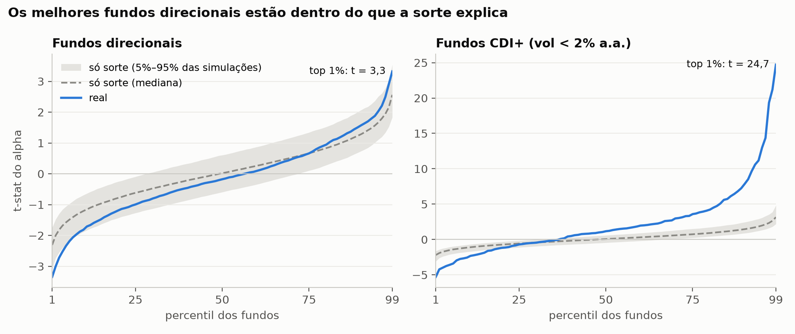
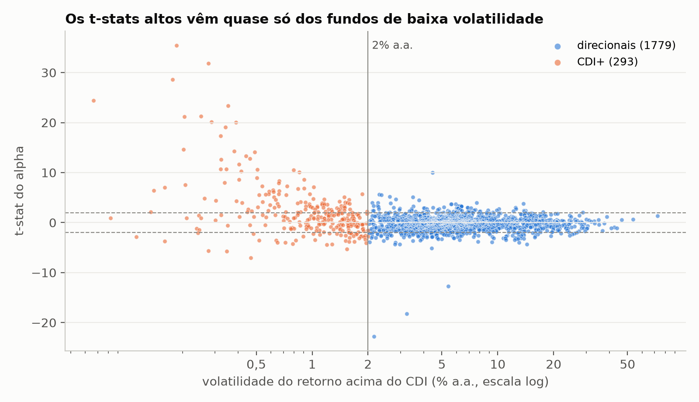
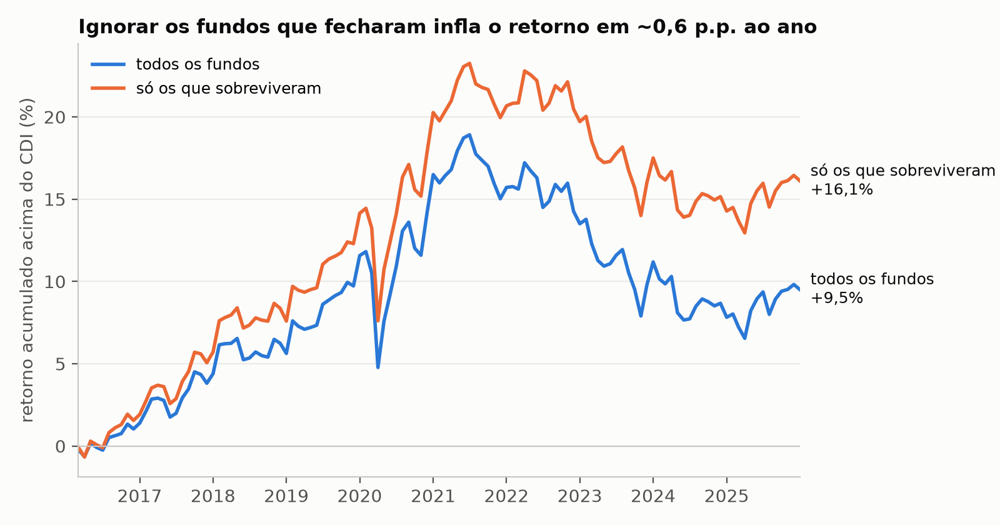

# Multimercados entregam alpha ou só CDI + bolsa?

Peguei todos os fundos multimercado abertos ao público no Brasil entre 2016 e 2025, incluindo os que fecharam no meio do caminho, e testei se o retorno acima do CDI vem de habilidade do gestor ou de exposição a mercado.

Resumo:

- Nos fundos direcionais (1.779), o alpha mediano é **−0,35% a.a.** depois de taxas. Os melhores não se distinguem do que a sorte produziria: o fundo no percentil 99 de t-stat supera 89% das simulações sem habilidade, e o do percentil 95 só 79%.
- Do lado ruim é diferente. O percentil 1 é pior do que 98% das simulações, ou seja, existem gestores consistentemente ruins.
- Os t-stats muito altos (10, 20, 30) aparecem em fundos com volatilidade abaixo de 2% a.a., quase sempre crédito privado marcado na curva. Isso é prêmio de crédito e liquidez, não habilidade.
- Olhar só os fundos que sobreviveram infla o retorno em **0,6 p.p. ao ano**. Com todos os fundos o alpha da carteira é −0,07% a.a.; só com os sobreviventes vira +0,53% a.a.



A linha azul é o t-stat do alpha real em cada percentil. A faixa cinza é onde ele estaria se nenhum fundo tivesse alpha (1.000 simulações). Nos direcionais a linha fica dentro da faixa na cauda direita.

## Dados

Tudo público:

- Informe diário da CVM (cota, patrimônio, cotistas) e os dois cadastros: o `cad_fi` antigo e o `registro_classe` da RCVM 175. Precisa dos dois porque fundo que fechou antes de 2024 só existe no antigo.
- CDI e dólar PTAX do SGS do Banco Central.
- Ibovespa do Yahoo Finance.
- Preços do Tesouro Direto (Tesouro Transparente).

O arquivo da CVM mudou de layout duas vezes no período (2021 e RCVM 175). Conferi a continuidade: de um mês para o outro ~99% dos fundos continuam aparecendo, inclusive nas viradas de layout.

### Filtros

| | fundos |
|---|---:|
| multimercados com dados no período | 23.247 |
| exclusivos | −8.994 |
| condomínio fechado | −3.671 |
| cripto | −70 |
| mediana de cotistas < 20 | −7.528 |
| patrimônio mediano < R$ 10 mi | −504 |
| **amostra** | **2.480** (835 encerrados) |

O filtro de cotistas é o que mais corta. 85% dos multimercados têm mediana de 1 cotista: são fundos exclusivos de família/empresa ou masters cujo único cotista é o próprio FIC. Tirar esses fundos também evita contar master e FIC duas vezes.

Erros de cota (mudança de unidade ou um mês com valor errado que volta no mês seguinte) são removidos. Foram só 4 em 160 mil retornos mensais.

## Modelo

Para cada fundo, com retornos mensais líquidos de taxa:

```
r - cdi = a + b1 (ibov - cdi) + b2 usd + b3 (ntnb - cdi) + e
```

`ntnb` é o retorno do Tesouro IPCA+ (sem cupom) com vencimento mais próximo de 10 anos. Usei isso no lugar do IMA-B porque a série da ANBIMA no SGS parou em 2023. Fundos com menos de 24 meses ficam fora das regressões individuais, mas entram na análise de sobrevivência.

**Sorte vs. habilidade.** Bootstrap de Fama & French (2010): tiro o alpha estimado de cada fundo, sorteio meses com reposição (os mesmos meses para todos os fundos, para manter a correlação entre eles) e reestimo. Repetindo 1.000 vezes sai a distribuição dos percentis de t(alpha) num mundo sem habilidade.

**Crédito.** Com tudo junto, o topo da distribuição era dominado por FIC de FIDC, crédito estruturado e consignado, com t-stat acima de 20. Esses fundos têm retorno liso porque marcam na curva, então um spread pequeno sobre o CDI vira um t-stat enorme. Separei os fundos com volatilidade abaixo de 2% a.a.:



| grupo | fundos | alpha mediano | t > 2 | t < −2 |
|---|---:|---:|---:|---:|
| CDI+ (vol < 2%) | 293 | +0,47% a.a. | 39% | 14% |
| direcionais | 1.779 | −0,35% a.a. | 5,3% | 7,8% |

Por acaso dá ~2,3% de cada lado. O corte de 2% não é mágico: a fração com t > 2 cai continuamente com a volatilidade (57% abaixo de 1%, 25% entre 1% e 2%, 11% entre 2% e 3%).

**Viés de sobrevivência.** Carteira igualmente ponderada de todos os fundos vivos em cada mês vs. a mesma carteira só com os fundos que existiam no fim de 2025:



| | acima do CDI | alpha | t |
|---|---:|---:|---:|
| todos os fundos | +0,97% a.a. | −0,07% a.a. | −0,10 |
| só sobreviventes | +1,57% a.a. | +0,53% a.a. | 0,77 |

Nenhum dos dois alphas é significativo, mas o sinal muda. O que sobra acima do CDI na carteira completa vem de beta de bolsa (0,13 com o Ibovespa).

## Limitações

- Retornos são líquidos de taxa. A pergunta respondida é se o gestor gera alpha suficiente para pagar a taxa, não se ele tem habilidade antes dela.
- O bootstrap sorteia meses de forma independente e ignora autocorrelação dos retornos.
- O corte de 2% de volatilidade é uma escolha minha.
- O filtro de cotistas pega a maioria dos masters, mas não necessariamente todos. Classes diferentes do mesmo fundo (ex.: "Advisory", "Access") contam como fundos separados.
- Fundos que mudaram de CNPJ aparecem como um que fechou e outro que abriu.

## Como rodar

Precisa do [uv](https://docs.astral.sh/uv/).

```
git clone https://github.com/danrodsg/Quant.git
cd Quant
uv sync

uv run python -m mmalpha.data      # baixa ~1 GB da CVM, guarda ~100 MB em data/
uv run python -m mmalpha.clean     # universo e retornos mensais
uv run python -m mmalpha.alpha     # regressões, bootstrap, sobrevivência -> results/
uv run python -m mmalpha.figures   # gráficos -> figures/

uv run python -m pytest
```

```
mmalpha/
  data.py      download
  clean.py     filtros, retornos, fatores
  alpha.py     regressões, bootstrap, sobrevivência
  figures.py   gráficos
results/       tabelas (alpha por fundo, bootstrap, sobrevivência)
```

## Referência

Fama, E. F. & French, K. R. (2010). Luck versus Skill in the Cross-Section of Mutual Fund Returns. *Journal of Finance*, 65(5), 1915–1947.
